# 🖥️ Active Directory Home Lab

Lab de infraestructura Windows construido desde cero con Windows Server 2019 en VirtualBox.
Simula un entorno corporativo real con dominio, usuarios, políticas de grupo y automatización.

## 🛠️ Tecnologías utilizadas
- Windows Server 2019
- Active Directory Domain Services (AD DS)
- Group Policy Management (GPO)
- DNS Server
- PowerShell

## 📋 Lo que se configuró

### 1. Dominio Active Directory
Creación del dominio `empresa.local` con estructura de Unidades Organizativas:
- OU: Departamentos → TI, RRHH, Administracion

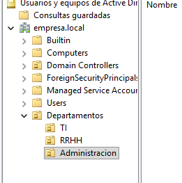

### 2. Usuarios y Grupos de Seguridad
- 3 usuarios creados manualmente en sus OUs correspondientes
- Grupo de seguridad `GRP_TI_Admins` con miembros asignados

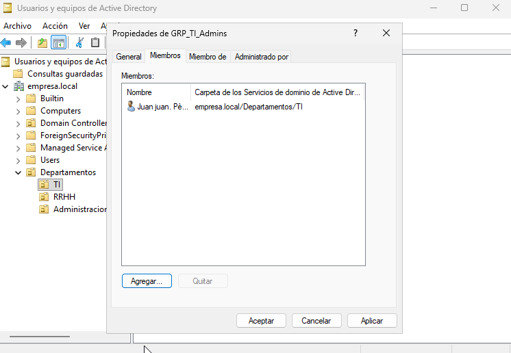

### 3. Group Policy (GPO)
Política `Politica_Escritorio` vinculada a la OU Departamentos:
- Impedir que usuarios cambien el fondo de pantalla

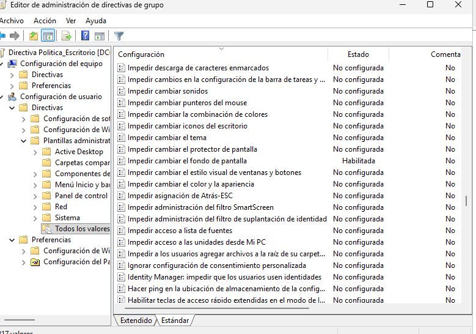

### 4. DNS Server
- Zona de búsqueda directa `empresa.local`
- Registro A manual: `servidor-web → 192.168.1.100`

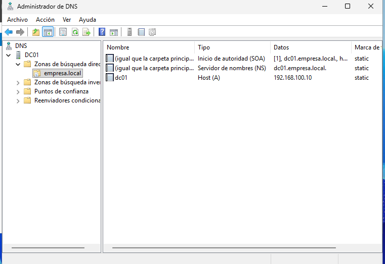

### 5. Automatización con PowerShell
Script para crear usuarios en masa desde código, asignándolos directamente a su OU.

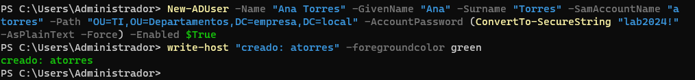

## 📁 Script incluido

```powershell
New-ADUser -Name "Ana Torres" -SamAccountName "atorres" `
  -Path "OU=TI,OU=Departamentos,DC=empresa,DC=local" `
  -AccountPassword (ConvertTo-SecureString "Lab2024!" -AsPlainText -Force) `
  -Enabled $true
```

## 📸 Capturas completas
| Paso | Descripción |
|------|-------------|
| 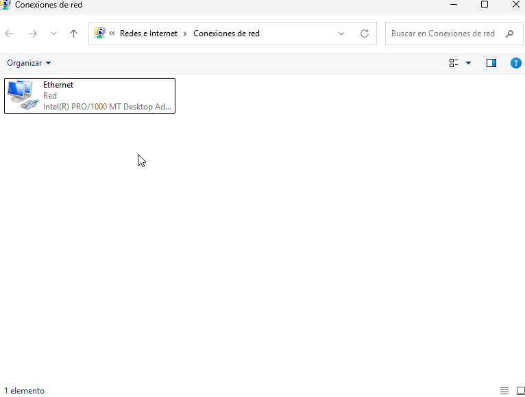 | AD DS instalado |
| 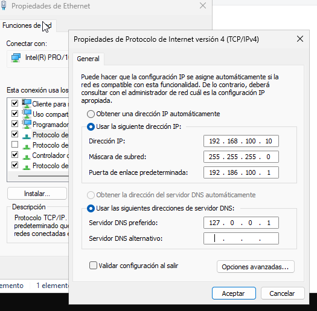 | AD DS instalado |
| 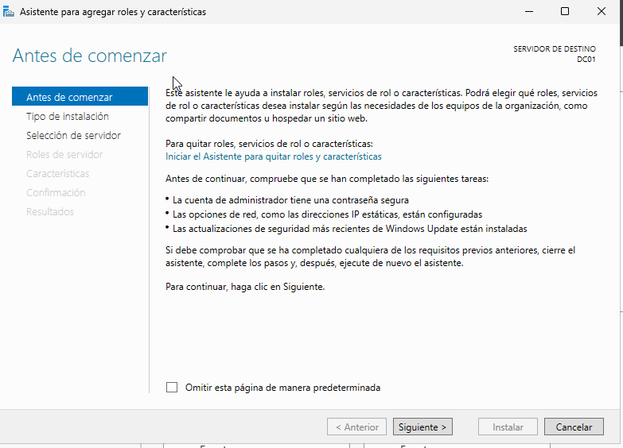 | AD DS instalado |
| 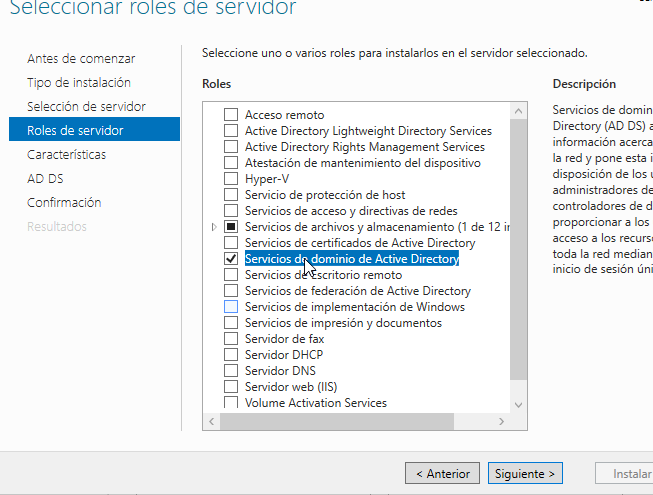 | AD DS instalado |
| 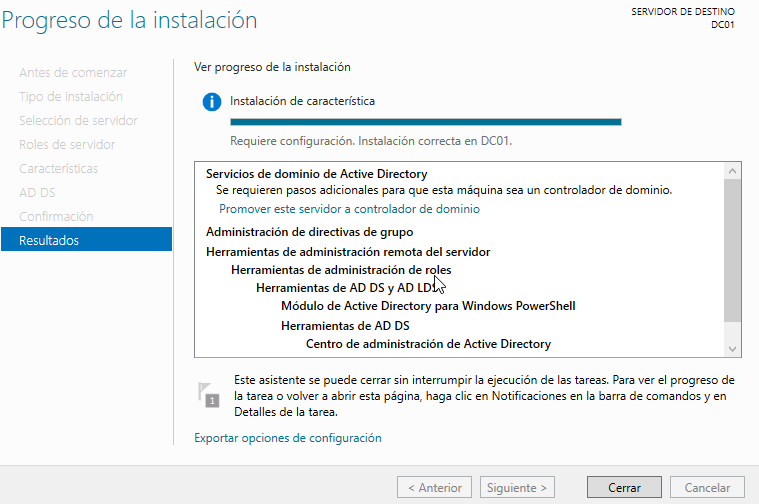 | AD DS instalado |
| 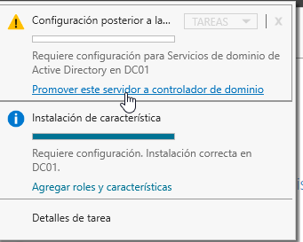 | AD DS instalado |
| 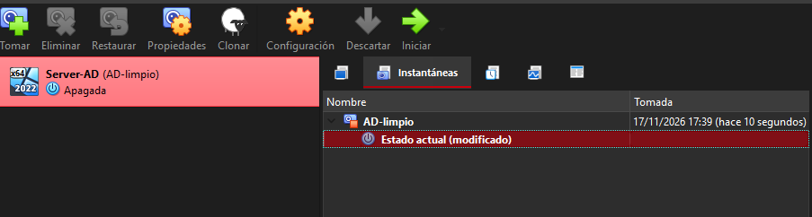 | Seguridad y respaldo |
| 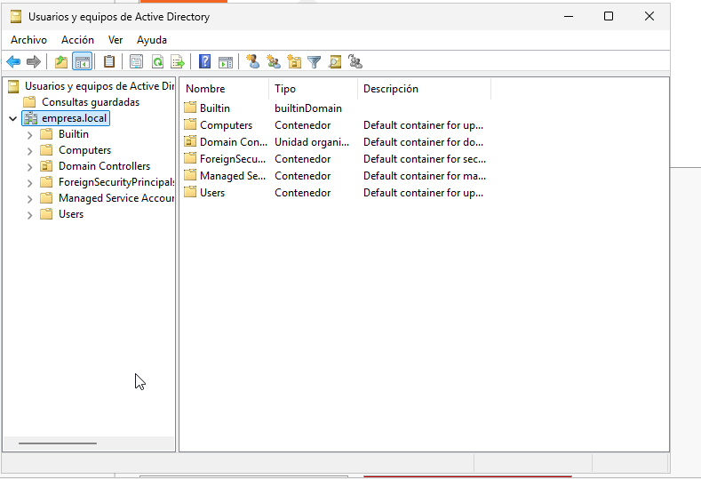 | Estructura de OUs |
|  | Estructura de OUs |
|  | Usuarios y grupo de seguridad |
|  | DNS zona principal |
| 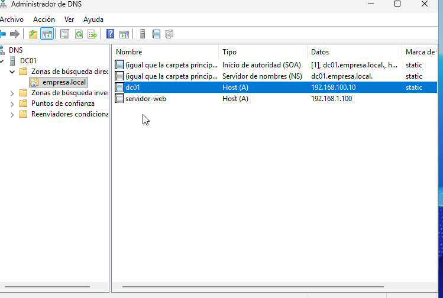 | DNS zona principal |
|  | Script PowerShell |
| 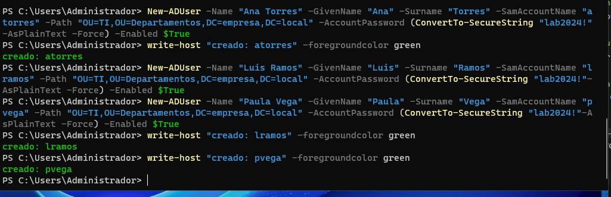 | Script PowerShell |

## 👤 Autor
Bryan Carreño Hidalgo — Egresado Ingeniería en Informática, INACAP La Granja
